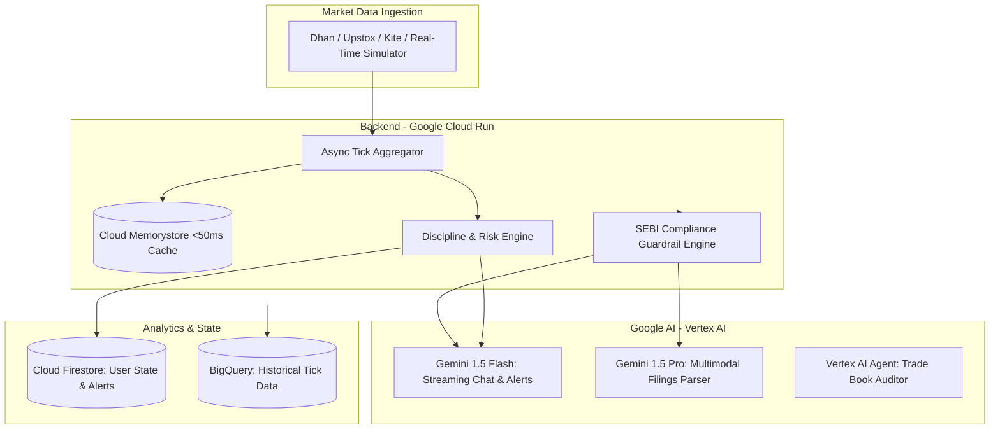

# TradeSense AI — AI Trading Co-Pilot & Risk-Intelligence Platform
**Startup Buildathon India 2026 Submission**  
*Target Market: Indian Retail Traders (NSE/BSE/F&O)*  
*Core Mission: Shift retail traders from high-risk emotional speculation to disciplined, data-backed risk management using Google AI and Google Cloud.*

---

## 🤖 Google AI Tools & Models (Dedicated Breakdown)

TradeSense AI uses a tiered, multi-model Google AI architecture on **Google Vertex AI** and the **Google GenAI SDK**, matching each task with the optimal model for latency, reasoning depth, and cost efficiency:

```
┌─────────────────────────────────────────────────────────────────────────────┐
│                           GOOGLE AI ARCHITECTURE                            │
├─────────────────────────┬─────────────────────────┬─────────────────────────┤
│     Gemini 1.5 Flash    │     Gemini 1.5 Pro      │ Vertex AI Agent Builder │
├─────────────────────────┼─────────────────────────┼─────────────────────────┤
│ • TTFT < 1.0s Streaming │ • 2M+ Context Window    │ • Autonomous Workflows  │
│ • Behavioral Risk Alerts│ • NSE Filings (PDFs)    │ • Trade Book Auditor    │
│ • Live PCR/IV Analytics │ • Earnings Transcripts  │ • Rule Breaker Cooldown │
│ • Bilingual Calm Nudges │ • Multimodal Charts     │ • Multi-Step Reasoning  │
└─────────────────────────┴─────────────────────────┴─────────────────────────┘
```

### 1. Google Gemini 1.5 Flash
* **Integration**: Google Vertex AI & Google GenAI SDK (`model="gemini-1.5-flash"`)
* **Role**: Real-Time Streaming Copilot & Behavioral Circuit Breakers
* **Latency Profile**: Ultra-low latency with **Time-to-First-Token (TTFT) < 1.0s**
* **Key Use Cases**:
  * **Real-Time Market Q&A**: Answers conversational user queries (e.g., *"What does a PCR of 1.35 mean for BankNifty today?"*) enriched with sub-50ms live tick data.
  * **Behavioral Risk Nudges**: Generates calm, rational 1-sentence alerts in Hindi and English when the Risk Engine detects emotional or revenge trading.
  * **Mathematical Derivatives Breakdown**: Explains Option Greeks, Implied Volatility (IV), and Max Pain clusters without predictive speculation.

### 2. Google Gemini 1.5 Pro
* **Integration**: Google Vertex AI & Google GenAI SDK (`model="gemini-1.5-pro"`)
* **Role**: Deep Multimodal Filing & Financial Document Intelligence
* **Context Capacity**: 2,000,000+ tokens
* **Key Use Cases**:
  * **Corporate Filing (PDF) Ingestion**: Digests complex 50+ page NSE corporate announcements, quarterly earnings releases, and annual reports.
  * **Operating Margin Extraction**: Isolates EBITDA margin expansion/contraction, revenue drivers, and balance sheet debt covenants.
  * **Management Interview & Audio Transcript Parsing**: Extracts forward-looking guidance and capex plans from management interviews.
  * **Multimodal Candlestick Analysis**: Reads chart screenshots to identify mathematical support/resistance levels and standard deviation bands.

### 3. Vertex AI Agent Builder & Function Calling
* **Integration**: Google Cloud Vertex AI Reasoning Engine / Function Calling API
* **Role**: Autonomous Risk & Trade Book Guardian
* **Key Use Cases**:
  * **Trade Book Auditor**: Autonomous agent that periodically audits user trade executions via read-only broker APIs.
  * **Revenge Trading Detector**: Detects rapid consecutive losses (>5 trades in 30 minutes following a drawdown) and triggers mandatory cooldown timers.
  * **Conversational Backtesting Compiler**: Parses natural language trade ideas into structured Python/BigQuery SQL backtesting parameters.

### 4. Vernacular Multilingual Prompt Engine
* **Integration**: System-guided prompt conditioning across Gemini 1.5 Flash & Pro
* **Supported Languages**: **Hindi (हिन्दी / Hinglish)**, **Gujarati (ગુજરાતી)**, **Marathi (मराठी)**, and **English**
* **Purpose**: Empowers tier-2 and tier-3 Indian retail traders by explaining complex derivative risks and corporate filings in their mother tongue.

---

## ☁️ Google Cloud & Firebase Supporting Infrastructure

| Google Cloud Service | Role in TradeSense AI | Performance Target |
| :--- | :--- | :--- |
| **Google Cloud Run** | Serverless microservices hosting FastAPI backends | Auto-scales to 0-100+ instances during 9:15 AM & 3:30 PM market spikes |
| **Cloud Memorystore (Redis)** | High-throughput in-memory cache for live ticks & option chains | **< 50ms read/write latency** |
| **Cloud Firestore** | Real-time NoSQL database for user alerts, journals & scorecards | Sub-second sync across web and mobile clients |
| **Google BigQuery** | Petabyte-scale data warehouse for historical tick data | Executes 1-year 5-min candlestick backtests in < 3 seconds |
| **Firebase Hosting** | Fast global CDN hosting for client applications | High-performance delivery for Flutter Web |

---

## 🛡️ SEBI Compliance & Safety Guardrails

TradeSense AI strictly complies with SEBI Research Analyst and Investment Advisor regulations:
1. **Zero Predictive Signals**: Never generates buy/sell recommendations, stock tips, or price targets.
2. **Pre-Flight Guardrail**: Automatically intercepts and blocks speculative questions (*"Should I buy Call option?"*), redirecting users to mathematical probability and risk metrics.
3. **Mandatory Disclaimer**: All AI outputs terminate with the mandatory statutory disclaimer:
   > *"TradeSense AI is an educational and analytical research platform. We do not provide direct buy/sell recommendations or financial advice. Trading in equities and F&O involves substantial risk of loss."*

---

## 🏗️ System Architecture



---

## ⚡ Quickstart & Local Development

### 1. Prerequisites
* Python 3.9+
* Git

### 2. Setup
```bash
git clone https://github.com/Aayush540-tech/TradeSense-AI.git
cd TradeSense-AI

# Create virtual environment & install dependencies
python3 -m venv .venv
source .venv/bin/activate
pip install -r backend/requirements.txt
```

### 3. Configure Environment
```bash
cp backend/.env.example backend/.env
# Add your GEMINI_API_KEY from https://aistudio.google.com/
```

### 4. Run Automated Test Suite (12 Tests)
```bash
PYTHONPATH=backend pytest backend/tests/
```

### 5. Start Development Server
```bash
PYTHONPATH=backend uvicorn app.main:app --reload --port 8000
```
* **Swagger API Docs**: [http://localhost:8000/docs](http://localhost:8000/docs)
* **WebSocket Market Stream**: `ws://localhost:8000/api/v1/stream/ws`
* **Streaming AI Chat (SSE)**: `http://localhost:8000/api/v1/chat/stream`
