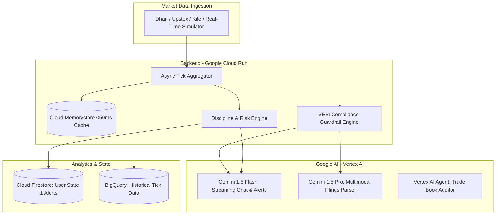

# TradeSense AI — AI Trading Co-Pilot & Risk-Intelligence Platform
**Startup Buildathon India 2026 Submission**  
*Target Market: Indian Retail Traders (NSE/BSE/F&O)*  
*Core Mission: Shift retail traders from high-risk emotional speculation to disciplined, data-backed risk management using Google AI and Google Cloud.*

---

## 🧠 1. Google AI Models

TradeSense AI leverages Google's state-of-the-art foundation models via Vertex AI and Google AI Studio:

| Model | Architecture & Specs | Primary Role in TradeSense AI | Key Use Cases |
| :--- | :--- | :--- | :--- |
| **Google Gemini 1.5 Flash** | • Ultra-low latency<br>• Streaming tokens<br>• **TTFT < 1.0s** | Real-Time Copilot & Behavioral Circuit Breakers | • Conversational risk Q&A with live index context<br>• Sub-second behavioral nudges (Hindi/English)<br>• Mathematical Put-Call Ratio (PCR) analysis<br>• Option Greeks & volatility breakdown |
| **Google Gemini 1.5 Pro** | • **2,000,000+ token** context<br>• Multimodal reasoning<br>• Complex document parsing | Deep Multimodal Financial Research | • Ingesting 50+ page NSE corporate filings (PDFs)<br>• Extracting EBITDA/operating margin impacts<br>• Parsing earnings call audio & transcripts<br>• Candlestick chart screenshot analysis |

---

## 🛠️ Google Tools & Cloud Developer Services

The developer tools, SDKs, and cloud platforms powering TradeSense AI's low-latency architecture:

| Category | Google Tool / Service | Technical Purpose in TradeSense AI |
| :--- | :--- | :--- |
| **AI / Agent Tools** | **Vertex AI Agent Builder** | Builds autonomous multi-step agents that audit user trade books, calculate consecutive loss frequency, and enforce cooldown rules. |
| **AI / Agent Tools** | **Vertex AI Function Calling** | Enables models to invoke structured local tools (e.g., query Redis cache, fetch live option chains, execute backtests). |
| **SDK / Libraries** | **Google GenAI SDK (`google-genai`)** | High-performance Python client managing asynchronous streaming, token callbacks, and multimodal byte uploads. |
| **Compute** | **Google Cloud Run** | Serverless microservice platform hosting FastAPI; automatically scales instances to handle 9:15 AM & 3:30 PM Indian market spikes. |
| **In-Memory Cache** | **Cloud Memorystore (Redis)** | High-throughput managed Redis cluster guaranteeing **< 50ms read/write latency** for live ticks and option chains. |
| **Real-Time Data** | **Cloud Firestore** | Real-time NoSQL database syncing behavioral trade journals, risk scorecards, and push notifications to web/mobile clients. |
| **Analytics Engine** | **Google BigQuery** | Serverless data warehouse storing historical tick datasets and executing SQL-based strategy backtests in seconds. |
| **Frontend Delivery**| **Firebase Hosting** | High-speed global CDN for distributing the Flutter Web application with SSL and edge caching. |

---

## 🛡️ SEBI Compliance & Safety Guardrails

TradeSense AI strictly complies with SEBI Research Analyst and Investment Advisor regulations:
1. **Zero Predictive Signals**: Never generates buy/sell recommendations, stock tips, or price targets.
2. **Pre-Flight Guardrail**: Automatically intercepts and blocks speculative questions (*"Should I buy Call option?"*), redirecting users to mathematical probability and risk metrics.
3. **Mandatory Disclaimer**: All AI outputs terminate with the mandatory statutory disclaimer:
   > *"TradeSense AI is an educational and analytical research platform. We do not provide direct buy/sell recommendations or financial advice. Trading in equities and F&O involves substantial risk of loss."*

---

## 🏗️ System Architecture



---

## ⚡ Quickstart & Local Development

### 1. Prerequisites
* Python 3.9+
* Git

### 2. Setup
```bash
git clone https://github.com/Aayush540-tech/TradeSense-AI.git
cd TradeSense-AI

# Create virtual environment & install dependencies
python3 -m venv .venv
source .venv/bin/activate
pip install -r backend/requirements.txt
```

### 3. Configure Environment
```bash
cp backend/.env.example backend/.env
# Add your GEMINI_API_KEY from https://aistudio.google.com/
```

### 4. Run Automated Test Suite (12 Tests)
```bash
PYTHONPATH=backend pytest backend/tests/
```

### 5. Start Development Server
```bash
PYTHONPATH=backend uvicorn app.main:app --reload --port 8000
```
* **Swagger API Docs**: [http://localhost:8000/docs](http://localhost:8000/docs)
* **WebSocket Market Stream**: `ws://localhost:8000/api/v1/stream/ws`
* **Streaming AI Chat (SSE)**: `http://localhost:8000/api/v1/chat/stream`
